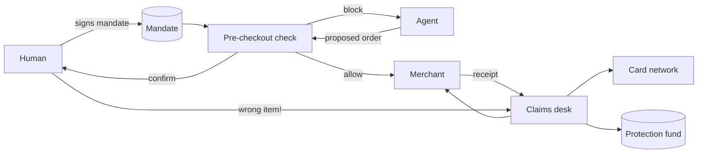

# Architecture — agent-buyer-protection

## 1. Scope
Verify every agent purchase against the human's mandate before checkout, and run the claim when
something slips through.
**MVP:** `Mandate` / `Order` model, violation checker with severities, `allow / confirm_with_human / block`
decision, claims desk with path selection, refund calculation and a case state machine.
**Product:** signed mandates (AP2-style intents), checkout SDK for agents and merchants, merchant
cancel/return APIs, protection fund underwriting.

## 2. System context

## 3. Rules
High severity: wrong item keywords, attribute mismatch, quantity over, unit price over cap, total
over cap, denied merchant. Medium severity: unknown attribute, quantity under, unapproved merchant,
late delivery. Decision: any high means `block`, any violation means `confirm_with_human`, otherwise `allow`.

## 4. Claims path selection (cheapest first)
`not shipped → cancel` · `returnable → merchant_return` · `card → chargeback` · `else → protection_fund`.
Refund: the whole order is refunded when the item itself is wrong. Otherwise only the overspend is
refunded (extra quantity × unit price + per-unit overcharge). Escalation re-routes to chargeback or
fund, and fund payouts are capped per claim.

## 5. Design decisions
- **Prevention before cure.** The pre-checkout check is the product, and claims are the backstop.
- **Overspend-only refunds** when the item is right. Customers keep what they wanted.
- **A state machine for cases** (`opened → merchant_contacted → resolved | escalated → paid`) with full history.

## 6. Production architecture
Checkout SDK (agent side) + merchant webhook (receipt), Postgres (mandates, orders, cases), and an
evidence bundle (mandate vs. order diff) attached to every claim for card disputes (Reg E / Visa CE 3.0 formats).

## 7. Risks
Fuzzy "wrong item" judgement needs an LLM-assisted matcher with human review above a value
threshold. Fund solvency is priced via agent-insure.
